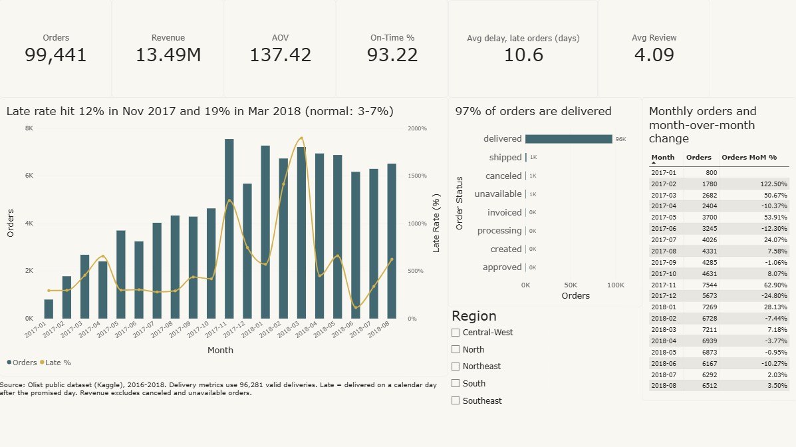
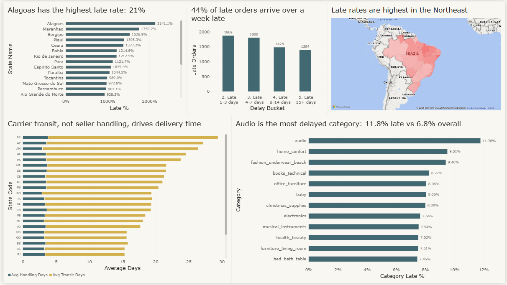
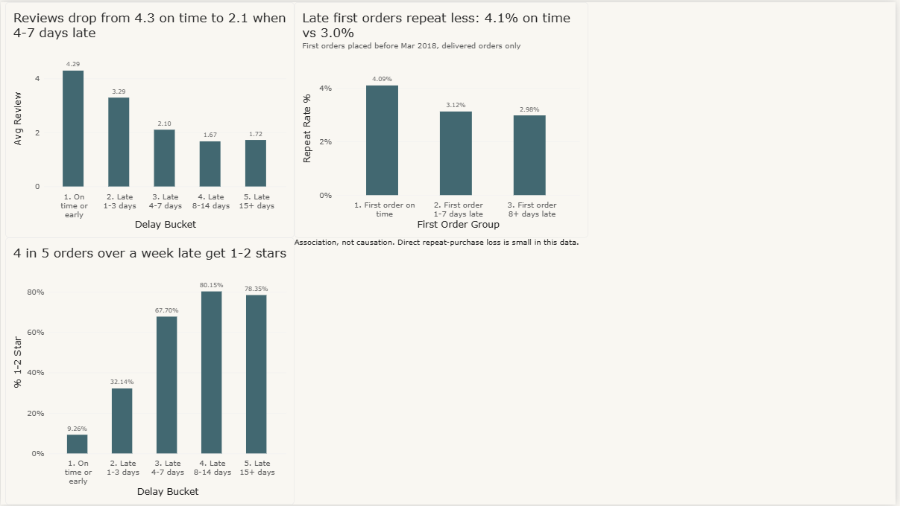
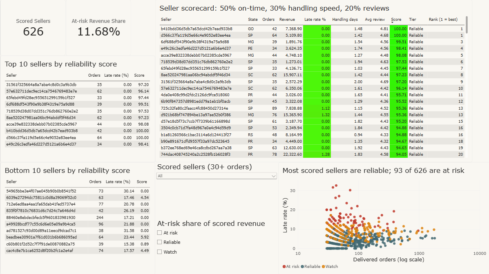

# Olist: Delivery and Seller Reliability Analysis

An end-to-end analysis of about 99,000 real marketplace orders (MySQL, Python, Power BI) that answers why deliveries are late, what lateness costs, and which sellers can be trusted. **6.78% of delivered orders arrive late, late orders score about 2 stars lower, and the extra time comes mostly from carrier transit rather than seller handling.**



## Business problem

Olist is a Brazilian e-commerce marketplace. Thousands of small sellers list products on it, and logistics partners deliver them. Olist does not own the stock or the trucks, but its brand depends on sellers shipping quickly and carriers delivering on time.

Operations leadership cannot currently see how big the lateness problem is, whether the delay comes from sellers, carriers or unrealistic delivery promises, or which sellers deserve trust.

**Stakeholders:** Head of Marketplace Operations and the Seller Success team.

**Questions answered**
1. How big is the lateness problem, and is it improving or worsening over time?
2. Is the delay from seller handling, carrier transit or over-optimistic delivery estimates?
3. Which states, product categories and sellers drive it?
4. What does lateness cost in review scores and repeat purchases?
5. Which sellers are reliable, and what should the marketplace do about the rest?

## Data

- **Source:** [Brazilian E-Commerce Public Dataset by Olist](https://www.kaggle.com/datasets/olistbr/brazilian-ecommerce) on Kaggle. Real, anonymised orders placed between 2016 and 2018.
- **Licence:** CC BY-NC-SA 4.0 (as listed on the Kaggle page). Used here for a non-commercial portfolio project. The Power BI file contains a processed extract of the data and carries the same licence.
- **Tables (9):** orders (99,441), order_items (112,650), order_payments (103,886), order_reviews (99,224), customers (99,441), sellers (3,095), products (32,951), geolocation (1,000,163), category_translation (71).
- The raw CSVs are not committed. Download them from Kaggle into `data/raw/`.

## Tools

MySQL 9 and MySQL Workbench, Python (pandas, NumPy, SciPy, SQLAlchemy, PyMySQL, matplotlib, seaborn) in Jupyter, Power BI Desktop, Git.

## Data-quality log and decisions

The full log is in `notebooks/02_data_quality_log.ipynb` and `docs/dq_*.csv`.

| Check | Rows affected | Decision | Reason |
|---|---|---|---|
| Orders not in `delivered` status | 2,963 | Exclude from delivery metrics; keep in cancellation and funnel metrics | No delivery to measure |
| Status delivered but no delivery date | 8 | Exclude | Contradictory record |
| Carrier pickup before purchase | 166 | Exclude from delivery metrics | Impossible sequence, timestamps unreliable |
| Customer delivery before carrier pickup | 23 | Exclude from delivery metrics | Impossible sequence |
| Status not delivered but has delivery date | 6 | Exclude; trust `order_status` | Contradictory record |
| Orders with no items | 775 | Exclude from revenue and seller metrics; keep in status counts | Nothing was sold or shipped |
| Orders with more than one seller | 1,278 | Seller metrics use one row per seller per order; excluded from the distance analysis | Carrier dates exist once per order |
| Orders with more than one payment row | 2,961 | Aggregate payments per order before joining | Prevents double counting |
| Orders with more than one review / repeated `review_id` | 547 / 814 | Keep the latest review per order | Prevents duplicate orders; `review_id` repeats across different orders, so it is not used to deduplicate |
| `customer_id` rows vs unique people | 3,345 | Use `customer_unique_id` for repeat purchase | `customer_id` is created per order |
| Geolocation fully duplicated rows | 261,831 of 1,000,163 | Average latitude and longitude per zip prefix | Many rows per prefix |
| Products with no category / category missing from translation | 610 / 13 | Fall back to the Portuguese name, else `unknown` | Keeps these items in the analysis |
| Products missing weight or size | 2 | Dropped from weight analysis only | Negligible |

**96,281 of 99,441 orders (96.82%), which is 99.8% of delivered orders, are usable for delivery analysis.** The 197 delivered orders that are dropped reconcile exactly: 166 + 23 + 8.

## Metric definitions

| Metric | Definition |
|---|---|
| Valid delivery | `delivered`, both delivery dates present, carrier date on or after purchase, customer date on or after carrier date (96,281 orders) |
| delivery_days | Customer delivery minus purchase, in fractional days |
| delay_days | Customer delivery **date** minus estimated delivery **date**, in whole days. Positive = late |
| is_late | 1 if delay_days > 0 |
| seller_handling_days | Carrier pickup minus purchase |
| carrier_transit_days | Customer delivery minus carrier pickup |
| estimate_days | Estimated delivery minus purchase |
| Revenue | Sum of item price, excluding freight and excluding canceled and unavailable orders |
| AOV | Revenue divided by number of orders |
| Review score per order | Score of the latest review for that order |

**Dates, not timestamps.** The estimated delivery is stored as a date at midnight, while actual delivery has a time. Comparing raw timestamps would mark a parcel that arrives at 3 pm on the promised day as late. The customer was promised a day, so "late" means delivered on a calendar day after the promised day.

**Grain.** Order-level metrics use one row per order. Seller metrics use one row per seller per order. Category metrics use one row per order per category. Delivery metrics use valid deliveries only; cancellation and funnel metrics use all orders. Trend charts cover purchases from Jan 2017 to Aug 2018, because the dataset has only a handful of orders in late 2016 and Sep-Oct 2018.

## Method

1. **Load** (`01_load_data.ipynb`): 9 CSVs into MySQL with explicit types, row-count reconciliation, primary keys and indexes.
2. **Data-quality log** (`02_data_quality_log.ipynb`): drives the exclusions above.
3. **SQL** (`sql/`): two views standardise every metric (`vw_order_base`, one row per order, and `vw_seller_scorecard`). Items, payments and reviews are aggregated to one row per order before joining, and total revenue from the view reconciles exactly to the raw table (BRL 13,591,643.70), which rules out join fan-out. 14 queries use CTEs and window functions:

| File | Question |
|---|---|
| 01_monthly_orders | Orders, revenue and AOV by month, with month-over-month growth (LAG) |
| 02_order_status | Order status distribution and cancel rate |
| 03_monthly_on_time | Monthly late rate and average delay |
| 04_state_late_rate | Late rate by state (RANK) and each state's share of all late orders |
| 05_delay_decomposition | Handling days vs transit days vs promised days, by state and for late vs on-time orders |
| 06_delay_buckets | Review score and 1-2 star share by how late the order was |
| 07_category_late_rate | Late rate and freight share of price by category |
| 08_seller_scorecard | Seller orders, revenue, late rate, handling days and review (30+ orders) |
| 09_seller_ranking_tiers | Within-state ranking (DENSE_RANK) and deciles (NTILE) |
| 10_revenue_concentration | Cumulative revenue share by seller (running total, Pareto) |
| 11_repeat_purchase | Repeat rate by how the first order went |
| 12_payment_mix | Payment types and instalments vs order value |
| 13_cohort_retention | Monthly cohort retention |
| 14_review_analysis | Comment share and average score by category |

4. **Python** (`03_delivery_analysis.ipynb`): haversine distance on zip-prefix centroids, Spearman correlations, late rate by distance, and Mann-Whitney with Cliff's delta for reviews.
5. **Seller score and impact** (`04_seller_score_and_impact.ipynb`): reliability score, sensitivity check, tiers, repeat-purchase cross-check and assumption-based impact.
6. **Power BI feed** (`05_build_powerbi_feed.ipynb`): builds the dashboard tables from `sql/16_powerbi_views.sql` and exports them.

## Findings

**1. Size and trend.** 6,531 of 96,281 valid deliveries (6.78%) arrived late; 93.22% were on time. 0.63% of orders were canceled (625), and 1.24% were canceled or unavailable (1,234). Monthly late rate stayed at 2.8-6.6% from Jan to Oct 2017, jumped to 12.4% in Nov 2017 (order volume was up 63% on October), then reached 14.1% in Feb 2018 and 19.0% in Mar 2018. Jan 2018 had a similar volume with only 5.7% late, so volume alone does not explain early 2018, and the cause cannot be identified from this data. In normal 2017 months the average order arrived about 12 days before the promise, but only 6.4 days before it in Mar 2018. Late rate then fell back to 1.2-6.6% from Apr to Aug 2018 (Apr 4.5%, May 6.6%, Jun 1.2%, Jul 3.4%, Aug 6.2%).

**2. Where the delay comes from.** Late orders took 33.9 days vs 11.0 for on-time orders, a gap of 22.9 days. Carrier transit explains 19.9 days of it (about 87%; 27.9 vs 8.0 days) and seller handling 3.1 days (about 13%; 6.1 vs 3.0). The promise was almost the same for both groups (22.6 vs 23.8 days), so late orders were not promised shorter times. Handling time is flat across states (2.8-3.7 days); transit varies from about 8 to 26 days. Alagoas, Maranhao and Sergipe have the smallest gap between promise and actual delivery (8.0, 8.9 and 9.3 days) and the highest late rates, while the remote states AP, AM and RR have the longest transit (23.5-25.6 days) but large cushions (16.6-19.1 days).

**3. Where.**
- By rate: AL 21.41% (about 3.2x the national rate), MA 17.51%, SE 15.27%, PI 13.95%, CE 13.77%. RR (12.20%) has only 41 orders, so it is too small to trust.
- By volume: RJ is late 12.12% of the time (about 1.8x the national rate) and has 12.81% of orders but 22.89% of all late orders. BA has 3.38% of orders but 6.05% of late ones. SP, the largest state, is late 4.5% of the time and holds 27.84% of all late orders.
- Matching every above-average state to the national rate would remove only 21.4% of late orders (RJ 659, BA 174, CE 89), so lateness is broad-based, not confined to a few states.
- Late rate rises with distance, from 4.5% under 50 km to 12.1% beyond 2,000 km (same state 4.6%, different state 8.1%). Across the 23 states with 200+ orders, late rate correlates -0.66 with the average buffer, +0.69 with transit time and +0.41 with distance (suggestive only; small sample, and buffer is mechanically related to lateness).
- Categories differ only slightly: audio is the most delayed at 11.8% late vs 6.8% overall. Category gaps are small next to state gaps.

**4. What lateness costs.**
- *Reviews:* average score falls from 4.29 (on time) to 3.29 (1-3 days late), 2.10 (4-7), 1.67 (8-14) and 1.72 (15+). The share of 1-2 star reviews rises from 9.3% to 32.1%, 67.7%, 80.2% and 78.4%. Late orders average 2.27 vs 4.29 (62.4% vs 9.3% give 1-2 stars); Cliff's delta is -0.64 (large), and a random on-time order outscores a random late one 81.9% of the time.
- *Written reviews:* 41.3% of reviews include a comment, rising to 76.6% for 1-star and 68.1% for 2-star reviews, so comments are a rich source of complaint themes. Weakest categories (100+ reviewed orders) are office_furniture (3.62), fashion_male_clothing (3.70) and audio (3.84), against an overall average of 4.09.
- *Repeat purchase:* customers repeated at 4.09% when the first order was on time, 3.12% when it was 1-7 days late and 2.98% when 8+ days late (first orders before Mar 2018; on time vs late 4.09% vs 3.05%, chi-square p = 0.002). Overall, repeat buying is rare in this marketplace.
- *Impact (assumption-based):* 3,669 customers had a late first delivery. If 25-100% of the 1-point repeat gap is caused by lateness, that is roughly 10-38 customers and BRL 1.3K-5.2K (average order value BRL 137). **The direct repeat-purchase loss is small; the larger cost is the damage to reviews.**
- All of these are associations, not proof of cause: sellers and products differ between late and on-time orders.

**5. Sellers.**
- 626 of 2,965 sellers with a delivered order (21%) have 30+ orders and are scored; they cover 77.1% of delivered-order revenue. The worst of them are 20-33% late vs 6.78% marketplace-wide.
- Late rate alone cannot separate a slow seller from an unlucky route: some high-late-rate sellers hand over to the carrier in about 2 days, while others take 11-15 days.
- Revenue is concentrated: the top 14 sellers (0.46% of 3,053 sellers with revenue) generate 16.74% of revenue, and 540 sellers (17.7%) generate 80%.

### Seller reliability score

Score = 50% on-time rate + 30% handling speed + 20% average review, each rescaled to 0-1 after capping at the 5th and 95th percentile. On-time gets the largest weight because it is the promise the project is about. Handling speed is the part of delay the seller controls (transit is the carrier's). Review gets the smallest weight because it is noisy and lateness already drives it.

- **Sensitivity:** against five alternative weightings, rank correlation is 0.94-0.98 and 85-92% of sellers keep their tier, but the exact top-20 overlap ranges from 11 to 18 out of 20. The ranking is robust at the tier level, not at the level of exact ranks.
- **Tiers** (bottom 15% / next 25% / top 60% by score, a judgement call):

| Tier | Sellers | Median late rate | Median handling days |
|---|---|---|---|
| Reliable | 376 | 3.7% | 2.1 |
| Watch | 157 | 8.7% | 3.4 |
| At risk | 93 | 13.9% | 5.2 |

At-risk sellers hold 11.7% of scored revenue (9.0% of all delivered-order revenue), so none should be removed without review.

## Recommendations (hypotheses to test, not proven fixes)

1. **Add a delivery-estimate buffer in high-late states (AL, MA, SE, CE, PI).** Hypothesis: a longer promise cuts the late rate without hurting conversion. Test: an A/B test randomised by order within a pooled set of these states, run for 2-4 weeks. Primary metric: late rate. Guardrails: conversion, cancellations and review score.
2. **Review carrier performance on the slowest routes.** Transit explains about 87% of the extra time on late orders. The data has no carrier id, so start by auditing the worst state-to-state routes.
3. **Introduce a seller handling-time SLA.** Handling explains only about 13% of the late-order gap, so expect a modest gain. Pilot it with the Watch tier.
4. **Use seller tiers for graduated action.** Warn At-risk sellers and coach Watch sellers.
5. **Plan capacity for peak periods.** Late rates hit 12.4% in Nov 2017 and 19.0% in Mar 2018; investigate what happened operationally in those months.

## Limitations

- The data is observational and covers 2016-2018 only, so every result is an association, not a cause.
- Multi-seller orders (about 1.3%) are excluded from the distance analysis.
- Distance is straight-line between zip-prefix centres, not road distance.
- There is no carrier id and no cost data, so impact is scenario-based.
- Only 626 sellers are scored, and top-20 membership is sensitive to the weights.
- The state-level correlations use 23 data points.
- The repeat-purchase window ends in Mar 2018.
- Orders still in transit when the data was extracted are excluded from delivery metrics.

## Power BI dashboard

`powerbi/olist_dashboard.pbix`. The data was exported from the MySQL views by notebook 05 as CSV files and imported (Import mode); to refresh it, run notebook 05 and point Power BI at `powerbi/data/`.

**Model:** `fact_orders` (one row per order) is linked many-to-one to `dim_date` (marked as a date table) on purchase date and to `dim_state` on customer state, both single-direction. `fact_order_category` (one row per order per category) and `dim_seller` (one row per seller with precomputed metrics, score and tier) are deliberately standalone: they are at a different grain, and linking them to orders would risk double counting because an order can have several sellers. Their measures are calculated at their own grain, so the dashboard has no category slicer on the seller page.

**Key DAX measures**
- `Orders`, `Active Orders`, `Revenue`, `AOV`: distinct counts and sums; revenue counts active (not canceled or unavailable) orders only.
- `Delivered Orders`, `Late Orders`, `Late %`, `On-Time %`: built with `CALCULATE` and `DIVIDE` on valid deliveries.
- `Avg Delay (late orders only)`: average delay days with an `is_late = 1` filter.
- `Avg Handling Days`, `Avg Transit Days`, `Avg Review`, `% 1-2 Star`: delivery and review measures.
- `Orders PM` and `Orders MoM %`: `DATEADD` on the date table, blank when either month is missing.
- `Repeat Rate %`: repeat customers among first orders placed before Mar 2018.
- `Category Orders`, `Category Late %`, `Scored Sellers`, `Seller Score`, `Seller Late Rate %`, `Seller Rank (1 = best)` (`RANKX`), `At-risk Revenue Share`.

**Pages**

| Page | What it shows |
|---|---|
| Overview | Six KPI cards, monthly orders and late rate, month-over-month table, order status, region slicer |
| Delivery performance | Late rate by state (map and ranked bar chart), handling vs transit days by state, delay buckets, category late rate |
| Customer impact | Average review and 1-2 star share by delay bucket, repeat rate by first-order lateness |
| Seller scorecard | Scored sellers with conditional formatting, tier and state slicers, top and bottom 10, orders vs late-rate scatter |





## Repository structure

```
sql/         00_setup, 00_views, queries 01-14, 15_seller_scores_note, 16_powerbi_views
notebooks/   01 load, 02 data-quality log, 03 delivery analysis, 04 seller score and impact, 05 Power BI feed
powerbi/     olist_dashboard.pbix, screenshots/, seller_scores.csv
docs/        dq_*.csv (data-quality log), figures/
requirements.txt
```

## How to reproduce

1. Install Python 3.10+, MySQL 8 or later, MySQL Workbench and Power BI Desktop.
2. Download the dataset from Kaggle and put the 9 CSVs in `data/raw/`.
3. Create the database with `sql/00_setup.sql` (the `CREATE DATABASE` line) and create a `.env` file in the project root:
   ```
   DB_USER=your_mysql_user
   DB_PASSWORD=your_password
   DB_HOST=localhost
   DB_PORT=3306
   DB_NAME=olist
   ```
4. Create the environment and install packages:
   ```
   python -m venv venv
   venv\Scripts\activate
   pip install -r requirements.txt
   ```
5. Run notebooks `01` and `02`, then run `sql/00_views.sql` in MySQL Workbench, then notebooks `03`, `04` and `05` in that order.
6. Open `powerbi/olist_dashboard.pbix`.
